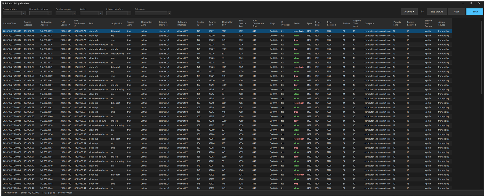
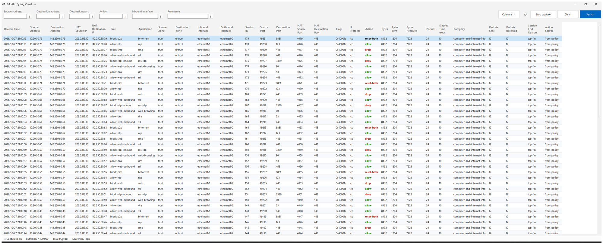

# PaloAlto Syslog Visualizer

A lightweight Windows app that receives traffic logs from a Palo Alto Networks firewall over syslog and shows them in a searchable table. It was built as a replacement for the Monitor tab on the PA-410, but it works with any PAN-OS firewall that can forward traffic logs.





## Features

- Receives traffic logs on **UDP port 514** and keeps the latest **100,000** in memory.
- **Search** shows the 50 most recent logs that match the filters. You can filter by source address, destination address, destination port, action, inbound interface and rule name.
- Each filter has a **`!` toggle** that inverts it, so it shows the logs that do *not* match.
- The **Action** column is color coded: allowed traffic in green, denied, dropped or reset traffic in red.
- **Light and dark themes**: the app follows the Windows setting by default, and the **Light mode / Dark mode** button switches it and remembers your choice.
- Handles bursts of more than 50,000 logs per second without dropping any.
- Uses about 230 MB of RAM with a full buffer, and very little CPU.
- Runs as a normal user; administrator rights are not needed.

## Requirements

- Windows 10 or 11
- [.NET Core 3.1 SDK](https://dotnet.microsoft.com/download/dotnet/3.1) to build. Visual Studio is not needed.

## Build and run

```
dotnet build
dotnet run --project "PaloAlto syslog visualizer"
```

The first time logs arrive from another machine, Windows Firewall may ask you to allow the app.

## Configure the firewall

1. **Device > Server Profiles > Syslog**: add a server with the IP address of the PC running the app, transport **UDP**, port **514** and format **BSD**.
2. **Objects > Log Forwarding**: create a profile that sends the **traffic** log type to that syslog server profile.
3. **Policies > Security**: on the **Actions** tab of each rule you want to see, select the log forwarding profile.
4. **Commit** the changes.

If the PC is not on the same network as the firewall's management interface, make sure the syslog traffic is allowed between them.

## Usage

- Fill in any filters and press **Search** (or Enter) to show the latest matching logs. The table does not refresh automatically.
- **Stop capture** pauses receiving, and **Start capture** resumes it.
- **Clean** empties the buffer and resets the counters.
- The status bar shows whether capture is on, how full the buffer is and the total number of logs received.

## Limitations

- Only traffic logs are supported. Other syslog messages are ignored.
- Not every field of the traffic log is stored. The full field list is in the [Palo Alto traffic log field descriptions](https://docs.paloaltonetworks.com/pan-os/10-1/pan-os-admin/monitoring/use-syslog-for-monitoring/syslog-field-descriptions/traffic-log-fields.html). If something important is missing, please open an issue.
- Flags are shown as raw values and are not decoded.
- There is no pagination: only the 50 most recent matching logs are shown.
- Search is only available on the fields listed above.
- Windows only, and the app has no icon yet.
- .NET Core 3.1 is no longer supported by Microsoft. Moving to .NET 8 only requires changing `TargetFramework` in the project file and installing the .NET 8 SDK.
- Parsing runs on a single thread. That is plenty for one firewall, but the app will not use more than about two CPU cores.
- The theme is applied at runtime, so the Visual Studio form designer shows the default colors.

## Changes in this fork

This is a fork of [M9k/PaloAlto-Syslog-Visualizer](https://github.com/M9k/PaloAlto-Syslog-Visualizer) with the following changes.

**Platform**
- Ported from .NET Framework 4.7.2 to .NET Core 3.1 with an SDK-style project, so it builds with the `dotnet` CLI.
- Background threads now stop with a flag instead of `Thread.Abort`, which .NET Core does not support. Before, this made Stop capture, Clean and closing the window crash.
- No longer requires administrator rights, since any Windows user can listen on UDP 514.

**Capture and buffer**
- Fixed the circular buffer wraparound. It now returns to the first slot and overwrites the oldest entry, and the status bar shows `100,000 / 100,000` when full.
- Fixed Search never showing the entry in the first slot.
- Non-traffic syslog messages are skipped. Before, each one left an empty entry that could crash Search.
- Buffer raised from 50,000 to 100,000 entries.
- No more dropped logs during bursts:
  - receiving and parsing run on separate threads connected by a queue, holding up to 200,000 messages;
  - the UDP receive buffer is raised to 32 MB.
  - In testing, 100,010 logs sent at about 54,000 logs per second all arrived. Before, about 1.2% were lost at 12,000 logs per second.

**Data**
- NAT Destination Address and NAT Destination Port now read the correct fields of the traffic log. Before, they showed the destination address and an IP address.

**Interface**
- Light and dark themes, including the title bar, scroll bars and status bar.
- Flat buttons, with Search as the primary button.
- Square `!` filter toggles with tooltips.
- A cleaner table: no row headers, alternating row colors, full-row selection, read-only cells and smoother scrolling.
- The window opens maximized when it is larger than the screen.
- The status bar is updated safely from the UI thread.
- Fixed typos in column headers and filter labels.

## License

Released under the "Anyone But Palo Alto Networks" license. See [LICENSE.md](LICENSE.md).
